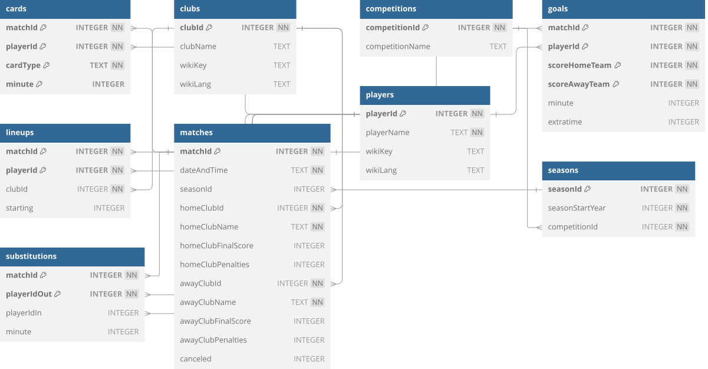

# Feyod: Feyenoord Open Data

## Introduction
This initiative is dedicated to making match data of the Dutch football club Feyenoord accessible to everyone. Feyenoord's rich history deserves to be open to all fans and data enthusiasts.

## Key Features
- **Comprehensive Database**: The core of this project is the `feyod.sql` file, which contains detailed match data of Feyenoord. This database captures player statistics, lineups, substitutions, and more.
- **Accessible Match Data**: By providing this data, we aim to foster an open environment where fans, analysts, and researchers can explore and analyze Feyenoord's match history.

## How to Use
1. Refer to `LICENSE` to understand potential opportunities and limitations for your use case.
1. Clone the repository to your local machine.
2. Import `feyod.sql` into your SQL database management system (SQLite is recommended).
3. Refer to the database diagram below to understand the data relationships and structure.
4. Explore the database!

## Downloads
Every push of `feyod.sql` to `main` automatically rebuilds these files. The links always point to the latest version:

- SQLite database: https://github.com/jeroenvdmeer/feyod/releases/latest/download/feyod.db
- CSV, one file per table (zip): https://github.com/jeroenvdmeer/feyod/releases/latest/download/feyod-csv.zip
- SQL dump: https://github.com/jeroenvdmeer/feyod/releases/latest/download/feyod.sql
- Parquet and the dataset viewer: https://huggingface.co/datasets/jeroenvdmeer/feyod

The data is released under CC0 1.0 (public domain dedication).

With the `datasets` library (one config per table; `matches` is the default):

```python
from datasets import load_dataset

matches = load_dataset("jeroenvdmeer/feyod", "matches")
print(matches["train"].to_pandas().head())
```

With pandas, reading a Parquet file straight from the Hub:

```python
import pandas as pd

df = pd.read_parquet("hf://datasets/jeroenvdmeer/feyod/matches.parquet")
```

With SQLite, after downloading `feyod.db`:

```python
import sqlite3

con = sqlite3.connect("feyod.db")
print(con.execute("SELECT COUNT(*) FROM matches").fetchone())
```

## Database diagram


## Contribution
Contributions from the community are always welcome! Whether it's adding more data or enhancing documentation, your input is invaluable.

## Disclaimer
This initiative is not affiliated with Feyenoord Rotterdam N.V.